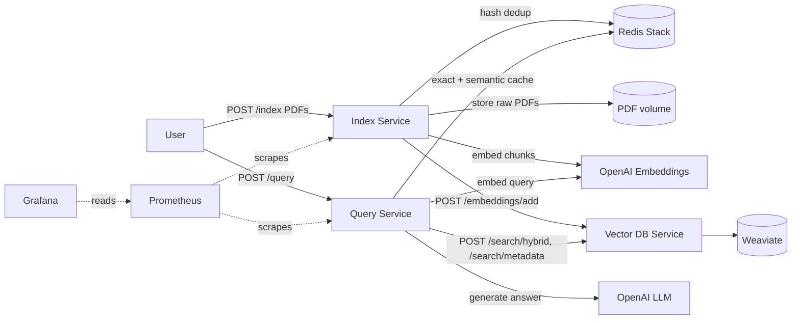

# rag_arxiv

A microservice-based **Retrieval-Augmented Generation (RAG)** system for question answering over arXiv papers. Upload PDFs, then ask questions in natural language and get concise, cited answers grounded only in the retrieved paper excerpts.

The system is split into three FastAPI services backed by Weaviate and Redis, ships with Dockerfiles and Kubernetes manifests (targeting AWS EKS), and includes Prometheus/Grafana monitoring and Langfuse tracing for LLM calls.

## Features

- **PDF ingestion pipeline**: upload one or more PDFs, which are chunked, embedded, and stored in a vector database.
- **Content-based deduplication**: files are hashed (SHA-256) and tracked in Redis, so the same PDF is never indexed twice.
- **Hybrid retrieval**: Weaviate hybrid search combining BM25 keyword matching and vector similarity (`alpha` blend, relative-score fusion).
- **Two-layer query cache** in Redis:
  - *Exact cache*: normalized query text, 1-hour TTL.
  - *Semantic cache*: RediSearch KNN over query embeddings, 24-hour TTL, with tiered reuse (see [Query flow](#query-flow)).
  - Both are keyed by a **corpus version** so stale answers can be invalidated when the document set changes.
- **Grounded answers**: the LLM is instructed to answer only from retrieved excerpts, cite sources as `[Paper ID:chunk]`, and say so when the context is insufficient.
- **Observability**: OpenTelemetry + Prometheus metrics endpoint (`/metrics`) on each API service, a Grafana deployment, and [Langfuse](https://langfuse.com/) traces for embedding and generation calls.
- **Deployable**: Dockerfiles per service and Kustomize manifests for the whole stack, driven by a `Makefile`.

## Architecture



| Service | Directory | Responsibility |
|---------|-----------|----------------|
| **Index Service** | `index_service/` | Accepts PDF uploads, deduplicates, chunks, embeds, stores raw PDFs, and sends vectors to the Vector DB service |
| **Query Service** | `query_service/` | Answers questions: cache lookup, query embedding, hybrid retrieval, LLM generation |
| **Vector DB Service** | `vector_db_service/` | Thin HTTP API in front of Weaviate (add vectors, hybrid search, metadata search) |
| **Redis (Stack)** | `k8s/redis/` | Dedup hash set and query caches (needs RediSearch, hence `redis-stack-server`) |
| **Weaviate** | `k8s/vector-db-service/` | Vector store with self-provided embeddings |
| **Prometheus / Grafana** | `k8s/prometheus/`, `k8s/grafana/` | Metrics collection and dashboards |

### Indexing flow

1. `POST /index` receives one or more files; non-`.pdf` files are skipped.
2. Each PDF is saved to a temp directory and hashed with SHA-256. Hashes already in Redis (`processed_pdf_hashes`) are skipped.
3. New PDFs are loaded with `PyPDFLoader` and split with `RecursiveCharacterTextSplitter` (**1000 chars, 200 overlap**). Each chunk gets `file_hash`, `chunk_id`, and `source` metadata.
4. Chunks are embedded with OpenAI `text-embedding-3-small` and POSTed to the Vector DB service (up to 5 retries, 2s apart).
5. Weaviate objects use **deterministic UUIDs** derived from `index_name + file_hash + chunk_id`, so re-inserting is idempotent.
6. The raw PDF is stored as `<sha256>.pdf` on the PDF volume.

### Query flow

1. **Exact cache**: lowercased and trimmed query text, matched against the current corpus version. A hit returns immediately.
2. The query is embedded.
3. **Semantic cache**: nearest cached query by cosine distance (KNN 1).
   - distance **≤ 0.2**: reuse the cached answer and sources as is.
   - distance **≤ 0.7** (but above 0.2): same topic, different phrasing. Reuse the cached *sources* and fetch those chunks by metadata, skipping hybrid search, then regenerate the answer.
   - otherwise: miss.
4. **Hybrid search** (BM25 + vector, `limit=5`, `alpha=0.5`) when there is nothing to reuse.
5. If nothing is retrieved, the service returns `"Insufficient relevant details in retrieved papers."` and caches nothing.
6. Otherwise the LLM (`gpt-5-nano`, minimal reasoning, 256 output tokens max) generates an answer from the labeled context, and the answer plus sources are written to both caches.

## API reference

### Index Service

| Method | Path | Description |
|--------|------|-------------|
| `POST` | `/index` | Multipart upload, field name `files` (one or many PDFs). Returns `{"message", "files_processed"}` |
| `GET` | `/health` | Liveness check |
| `GET` | `/metrics` | Prometheus metrics |

### Query Service

| Method | Path | Description |
|--------|------|-------------|
| `POST` | `/query` | Body: `{"user_query": "..."}`. Returns `{"message", "model_response", "sources"}` |
| `GET` | `/health` | Liveness check |
| `GET` | `/metrics` | Prometheus metrics |

`sources` is a list of `{"id", "chunk_id", "file_hash"}` objects. The `message` field tells you which path served the request (`Success`, `Success (Exact Cache Hit)`, `Success (Semantic Cache Hit - Score: ...)`, or `No matches`).

### Vector DB Service (internal)

| Method | Path | Description |
|--------|------|-------------|
| `POST` | `/embeddings/add` | Insert `texts`, `embeddings`, `metadatas` (each metadata needs `file_hash` and `chunk_id`) |
| `POST` | `/search/hybrid` | Hybrid search: `query_text`, `query_embedding`, `limit`, `alpha` |
| `POST` | `/search/metadata` | Fetch chunks by a list of `{id, chunk_id, file_hash}` filters (OR of ANDs) |
| `GET` | `/health` | Liveness check |

## Tech stack

- **API**: Python 3.11, FastAPI, Gunicorn + Uvicorn workers
- **LLM / embeddings**: OpenAI (`gpt-5-nano`, `text-embedding-3-small`) via LangChain and the OpenAI SDK
- **Vector store**: Weaviate (self-provided vectors, hybrid search)
- **Cache / dedup**: Redis Stack (RediSearch vector index)
- **PDF parsing**: `pypdf` through LangChain's `PyPDFLoader`
- **Observability**: OpenTelemetry, Prometheus, Grafana, Langfuse
- **Infra**: Docker, Kubernetes (Kustomize), AWS ECR / EKS (gp3 storage class)

## Repository structure

```
.
├── Makefile                      # Deploy / clean / port-forward helpers
├── requirements.txt              # Shared pinned dependencies for all services
├── index_service/
│   ├── Dockerfile
│   └── app/                      # index_api.py, vector_store_manager.py,
│                                 # pdf_store_manager.py, redis_manager.py, ...
├── query_service/
│   ├── Dockerfile
│   └── app/                      # query_api.py, vector_search_manager.py,
│                                 # redis_cache_manager.py, llm_generation_manager.py, ...
├── vector_db_service/
│   ├── Dockerfile
│   └── app/                      # vector_db_api.py, vector_db_manager.py
└── k8s/
    ├── redis/  index-service/  query-service/  vector-db-service/
    ├── prometheus/  grafana/
    └── infra/storage/            # gp3 StorageClass
```

## Configuration

Each service reads environment variables (a local `.env` file is loaded via `python-dotenv`). On Kubernetes, they come from per-service secrets generated from git-ignored env files.

**Index service** (`k8s/index-service/index_service.env`)

| Variable | Description |
|----------|-------------|
| `OPENAI_API_KEY` | OpenAI key for embeddings |
| `VECTOR_DB_API_URL` | Full URL of the Vector DB add endpoint, e.g. `http://vector-db-service/embeddings/add` |
| `PDF_STORAGE_PATH` | Where raw PDFs are stored, e.g. `/app/data/pdfs` |
| `REDIS_HOST`, `REDIS_PORT`, `REDIS_DB`, `REDIS_PASSWORD` | Redis connection (defaults: `localhost`, `6379`, `0`, none) |
| `LANGFUSE_PUBLIC_KEY`, `LANGFUSE_SECRET_KEY`, `LANGFUSE_HOST` | Langfuse tracing |

**Query service** (`k8s/query-service/query_service.env`)

| Variable | Description |
|----------|-------------|
| `OPENAI_API_KEY` | OpenAI key for query embeddings and generation |
| `VECTOR_DB_HYBRID_SEARCH_URL` | e.g. `http://vector-db-service/search/hybrid` |
| `VECTOR_DB_METADATA_SEARCH_URL` | e.g. `http://vector-db-service/search/metadata` |
| `REDIS_*` | Same as above |
| `LANGFUSE_*` | Same as above |

**Vector DB service** (`k8s/vector-db-service/vector_db_service.env`)

| Variable | Default |
|----------|---------|
| `WEAVIATE_HTTP_HOST` / `WEAVIATE_HTTP_PORT` | `weaviate` / `8080` |
| `WEAVIATE_GRPC_HOST` / `WEAVIATE_GRPC_PORT` | `weaviate` / `50051` |
| `COLLECTION_NAME` | `arxiv_papers_docs` |
| `INDEX_NAME` | `arxiv_papers_index` |

Model names, chunk sizes, and `TOP_K` are set in each service's `config.py`.

> Langfuse is switched on by `LANGFUSE_AVAILABLE = True` in each `config.py`, so provide Langfuse credentials or set that flag to `False`.

## Running locally

**Prerequisites:** Python 3.11, Docker, an OpenAI API key.

1. **Install dependencies**

   ```bash
   python -m venv .venv && source .venv/bin/activate
   pip install -r requirements.txt
   ```

2. **Start Redis Stack and Weaviate**

   ```bash
   docker run -d --name redis -p 6379:6379 redis/redis-stack-server:latest

   docker run -d --name weaviate -p 8080:8080 -p 50051:50051 \
     -e QUERY_DEFAULTS_LIMIT=20 \
     -e AUTHENTICATION_ANONYMOUS_ACCESS_ENABLED=true \
     -e PERSISTENCE_DATA_PATH=/var/lib/weaviate \
     -e DEFAULT_VECTORIZER_MODULE=none \
     semitechnologies/weaviate:latest
   ```

3. **Start the services.** Imports are flat (`import config`), so run each service from its own `app` directory, each in a separate terminal. Put a `.env` with the variables above in each directory.

   ```bash
   # Vector DB service
   cd vector_db_service/app
   WEAVIATE_HTTP_HOST=localhost WEAVIATE_GRPC_HOST=localhost \
     uvicorn vector_db_api:app --port 8000

   # Index service
   cd index_service/app
   VECTOR_DB_API_URL=http://localhost:8000/embeddings/add PDF_STORAGE_PATH=./data/pdfs \
     uvicorn index_api:app --port 9000

   # Query service
   cd query_service/app
   VECTOR_DB_HYBRID_SEARCH_URL=http://localhost:8000/search/hybrid \
   VECTOR_DB_METADATA_SEARCH_URL=http://localhost:8000/search/metadata \
     uvicorn query_api:app --port 9001
   ```

4. **Index some papers and ask a question**

   ```bash
   curl -X POST http://localhost:9000/index \
     -F "files=@attention_is_all_you_need.pdf" \
     -F "files=@another_paper.pdf"

   curl -X POST http://localhost:9001/query \
     -H "Content-Type: application/json" \
     -d '{"user_query": "How does scaled dot-product attention work?"}'
   ```

## Deploying to Kubernetes

The manifests target AWS EKS (gp3 storage class, ECR images) but are plain Kustomize and easy to adapt.

1. **Build and push the images** from the repository root (the Dockerfiles copy the root `requirements.txt`):

   ```bash
   docker build -f index_service/Dockerfile      -t <registry>/index-service:latest .
   docker build -f query_service/Dockerfile      -t <registry>/query-service:latest .
   docker build -f vector_db_service/Dockerfile  -t <registry>/vector-db-service:latest .
   docker push <registry>/index-service:latest   # and the other two
   ```

2. **Update image references.** The deployments currently point at a specific ECR registry (`.../index-service:latest`, `.../query-service:latest`, and the vector DB deployment). Change them to your own registry.

3. **Create the env files** (git-ignored) that Kustomize turns into secrets:

   - `k8s/index-service/index_service.env`
   - `k8s/query-service/query_service.env`
   - `k8s/vector-db-service/vector_db_service.env`

   Inside the cluster, services reach each other by name (e.g. `http://vector-db-service/search/hybrid`, `REDIS_HOST=redis`, `WEAVIATE_HTTP_HOST=weaviate`).

4. **Apply the storage class** (EKS gp3), then deploy everything:

   ```bash
   kubectl apply -f k8s/infra/storage/storageclass-gp3.yaml
   make deploy
   ```

### Makefile targets

| Target | What it does |
|--------|--------------|
| `make deploy` | Creates the `rag-arxiv-app` namespace and applies every Kustomize directory (default target) |
| `make clean` | Deletes deployments, services, and secrets but keeps PVCs |
| `make clean-all` | Deletes everything including PVCs |
| `make redeploy` | `clean-all` followed by `deploy` |
| `make port-forward-all` | Forwards index (9000), query (9001), vector DB (8000), Prometheus (9090), and Grafana (3000) to localhost |

The index and query services are also exposed through `LoadBalancer` services (`index-service-lb`, `query-service-lb`).

## Monitoring

- Both API services expose Prometheus metrics at `/metrics`; `k8s/prometheus/prometheus.yml` scrapes them every 15s.
- Index service metrics: `pdfs_indexed_total` (labeled by status) and `pdf_indexing_duration_seconds`.
- Query service metrics: request metrics from the FastAPI instrumentation plus custom latency histograms for cache lookup and hybrid search.
- After `make port-forward-all`, open Prometheus at http://localhost:9090 and Grafana at http://localhost:3000 (add Prometheus as a data source at `http://prometheus:9090`).
- LLM and embedding calls are traced in Langfuse with token usage; FastAPI/Starlette spans are deliberately excluded so traces stay focused on model calls.

## Notes and limitations

- PDF storage currently supports the local filesystem only (a PVC on Kubernetes). The S3 provider for `PROD` mode is not implemented yet.
- Services are deployed as a single replica each.
- Weaviate is configured with anonymous access, so keep it internal to the cluster.
